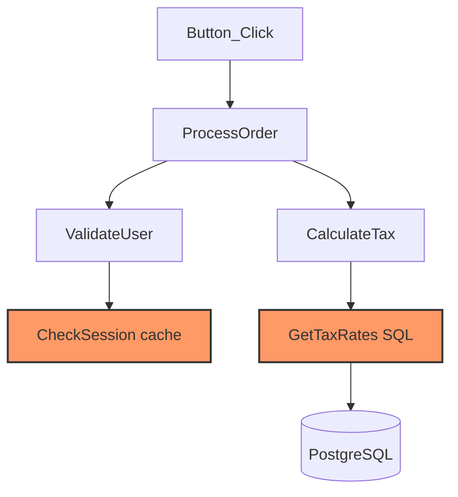

My first big project was moving a large VB codebase to .NET. I had to do it hand: line-by-line rewrites, fixing SQL injection holes, and porting T-SQL to PostgreSQL functions. Some of the code-behind files were 2,000 lines of `.aspx.vb`.

The slow part wasn't rewriting the code but instead working out what each piece of code touched. So I built a tool that does that part: a Migration Graph Engine. It gets about 70% of files right on the first pass.

## Build the graph first

An `.aspx.vb` file usually leans on shared modules, global variables, utility classes and database wrappers. Searching for text doesn't find all of that.

The engine parses the codebase and builds a directed graph of function dependencies. When it sees a call like `UpdateUser()`, it finds the implementation, even if that is in another file such as `DBHelper.vb`, parses it, and adds it as a child node.

It keeps going until it reaches leaf nodes: raw SQL, file access, external API calls. Those are where the system actually does something.

From the leaves you can trace data lineage:

```text
UserID → function parameter → SQL query
```

That makes it possible to find every query, spot injection risks, and see where user input enters the system.

## Keyword watchlist

A small table of legacy patterns tells the migration step what to do with each:

| Category | Legacy pattern | Target |
|---|---|---|
| Data access | `SqlCommand`, `SqlDataReader` | Repository pattern |
| State | `Session()`, `ViewState()` | DTOs or scoped services |
| Cross-file | `Module`, `Public Shared` | Dependency injection |
| UI coupling | `Me.DataBind()`, `sender` | Logic moved to an API layer |

## Small packets instead of whole files

Give a model a 2,000-line file and it loses track of types and scope. So the engine starts at an entry point, such as a `Button_Click` handler, and collects only what that handler reaches.



Each packet is 300 to 500 lines: the handler, its internal calls, and the external code found during traversal.

## Migrate in order

Migration goes bottom-up so the model never has to invent missing infrastructure:

1. Shared modules and database wrappers go first, into .NET services and libraries.
2. When a page is migrated, the model gets the already-converted C# services and the target architecture.
3. Legacy SQL isn't translated string by string. A rule maps it to the new service, for example a legacy update call becomes `IUserRepository.Update()`.

## Results

- About 70% first-pass accuracy, including on very large code-behind files.
- Raw SQL is found and rewritten as parameterized Postgres queries.
- The output has service layers, dependency injection and cleaner API boundaries.

## Takeaway

Legacy migrations are slow because understanding the system is hard. Once the dependencies are mapped, the rewriting is the easy part.
