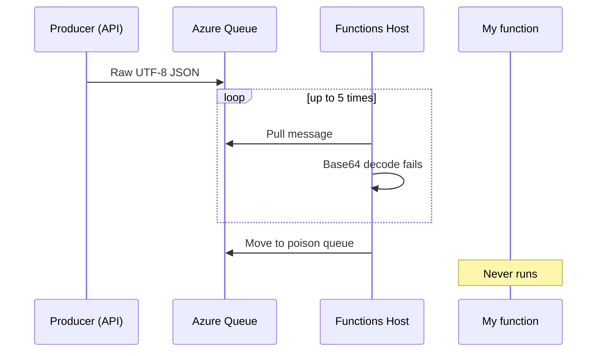

I was making PluckIt's image upload async. The API returns `202 Accepted`, and a queue-triggered Azure Function does the image processing.

Messages landed in `image-processing-jobs-poison` in under a second, with no invocation logs and no stack trace.

## The symptom

- The API returned 202 and the draft was saved to Cosmos DB.
- The function never fired.
- The host logged this and nothing else:

```text
Message has reached MaxDequeueCount of 5. Moving message to queue 'image-processing-jobs'.
```

Since none of my code ran, the problem had to be in the host or the binding.

## What I tried

I spent an hour flipping the producer between `None` and `Base64`, and tried forcing encodings on the trigger attribute. I also doubted the `QueueTrigger` registration, thinking the host couldn't see the function. None of it helped.

What worked was running the host with verbose logging:

```bash
func start --port 7072 --verbose
```

The logs showed `QueuesOptions` defaulting to Base64 encoding, whatever my local config said.

## The cause

The host expected Base64. My producer was sending raw UTF-8 JSON.



Each failed decode counted as a dequeue, so the host burned through all five attempts instantly and poisoned the message.

## The fix

Make the producer match the host.

```csharp
// Before
var queueClient = new QueueClient(queueConnStr, queueName,
    new QueueClientOptions { MessageEncoding = QueueMessageEncoding.None });

// After
var queueClient = new QueueClient(queueConnStr, queueName,
    new QueueClientOptions { MessageEncoding = QueueMessageEncoding.Base64 });
```

I also set it explicitly in `host.json` so both sides say the same thing in every environment:

```json
{
  "extensions": {
    "queues": {
      "messageEncoding": "base64"
    }
  }
}
```

The function ran on the next message:

```text
[2026-03-04T16:46:16.705Z] Executing 'Functions.ProcessImageJob' (Reason='New queue message detected...')
[2026-03-04T16:46:16.713Z] ProcessImageJob: starting for item test-base64-001...
[2026-03-04T16:46:16.744Z] Executed 'Functions.ProcessImageJob' (Succeeded)
```

## Takeaways

- A message in the poison queue with no code executed means a binding or encoding problem. Check that first.
- Producer and consumer have to agree on the encoding.
